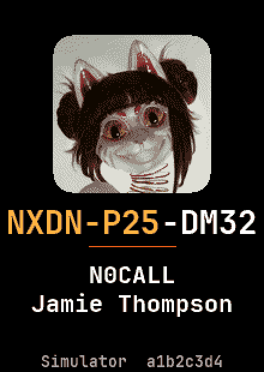

# DM32-nxdn-p25 — NXDN-P25-DM32 multimodo (FM · DMR · P25 · NXDN) para el Baofeng DM-32UV

[](https://throne.com/lyraarsgoetia) [](https://ko-fi.com/lyraarsgoetia)

**¿Quieres firmware para tu radio?** Regálamelo desde mi lista de deseos y lo porto: **<https://throne.com/lyraarsgoetia>** · *Want firmware for your radio? Gift it from my wishlist and I'll port it.*

Firmware abierto y multimodo para el **Baofeng DM-32UV**: FM, DMR, **APCO P25 fase 1** y **NXDN48** (RX y TX) en canales convencionales, más modo troncal P25 fase 1 con TX experimental y permiso explícito por canal. Es una derivación de [Open25-DM32](https://github.com/tylerwatt12/Open25-DM32) (tylerwatt12), construida como serie de parches sobre [RadioFoundry](https://github.com/RadioFoundry/RadioFoundry). Esta rama la mantiene **lyra XE1POC**.

> Firmware experimental. Úsalo bajo tu responsabilidad, solo en frecuencias en las que tengas licencia y con un respaldo de tu radio.

## Estado (17 de noviembre de 2026)

| Función | Estado |
|---|---|
| FM y DMR | Primer PTT DMR sin voz al entrar en DMR (desde P25, NXDN o FM): causa medida en la radio. El tono de permiso dejaba encendido el amplificador del altavoz durante la TX y el micrófono llegaba plano (3 dB contra 39 dB). Con el tono apagado ya salía la voz. Arreglado en `0043`; falta confirmarlo con esta versión en la radio. Otros fallos de acceso al hotspot de #3 siguen abiertos |
| Mensajes DMR de texto libre | Hasta 140 caracteres desde Contactos; revisión antes de enviar. Compilado y probado en simulador, pendiente de probar en el aire |
| P25 convencional, RX y TX | Verificado en la radio (voz IMBE en ambos sentidos) |
| NXDN48, RX | Verificado en la radio (tramas, llamada y voz AMBE sin errores) |
| NXDN48, TX | El receptor del firmware y dsd-fme decodifican la TX del DM-32 (RAN 1, TG 1, voz), capturada con un Pluto+. Hay reportes de radios Icom, un repetidor Kenwood y hotspots MMDVM que no la decodifican; pendiente medir la desviación. Solo NXDN48 (Icom «VN», 6,25 kHz), no NXDN96 |
| Troncal P25 | Modo P25 Trunk en canal y VFO, fase 1, VHF/UHF. WACN/System ID editables en la radio. RX por defecto; TX experimental con permiso explícito por canal y sistema/ID completos. Sin registro, el PTT registra y luego pide canal; la pantalla dice si el sistema rechazó o no respondió. Sin validar en un sistema real |
| AES-256 P25/DMR | Cuatro claves configurables en el CPS web para voz convencional. La clave de cada canal se elige en el CPS o en el menú de canal de la radio. Hasta `0044` el editor web rechazaba los canales con AES porque la radio no informaba `DV_AES`. Pruebas de protocolo y persistencia. Interoperabilidad con otras radios pendiente; véanse los [límites](docs/aes256.md) |
| Tono de fin de llamada DMR | Interruptor independiente en Ajustes › Sonidos; habilitado por defecto |
| APRS y posición GPS | Activados en esta versión; sin probar en el aire |
| Tono de permiso estilo Motorola | P25/NXDN: TPT ASTRO 25 (3 bips de 910 Hz); DMR: chirp MOTOTRBO |
| Tema «Rosa» | Tema claro rosa (Ajustes › Pantalla › Tema › Rosa) |
| AM de aviación (108-136 MHz) | `0046`: ganancia automática corregida para que el demodulador AM no sature, y squelch por ruido. Probado en host y con un modelo de lazo cerrado; **pendiente de oírlo en la radio** (véase abajo) |
| Recepción ampliada | Solo RX: 174-260, 350-400 y 480-520 MHz, con menos sensibilidad fuera de los filtros. TX sigue en 136-174 / 400-480 |
| Página de diagnóstico | Fuera de la imagen: libera 1,4 KB de RAM y 4 KB de flash. En Herramientas desaparece la fila Diagnóstico (las siguientes suben un número) y las lecturas de la placa y los contadores del módem DMR dejan de estar disponibles, en la pantalla y en `diag` del enlace de depuración. `--diag` las conserva en una compilación propia |

## Hotspots, repetidores y otras radios

NXDN es solo NXDN48 (Icom «VN»). El NAC/RAN de **TX** debe coincidir con el del otro equipo; Pi-Star usa NAC 293
y RAN 1. Si el hotspot necesita un offset de cientos de Hz, corrige la radio en **Ajustes › Avanzado › Ajuste frec** (Freq trim).
Véase la [guía de usuario](docs/user-guide.md#hotspots-repeaters-and-other-radios).

## AM de aviación: saturación

El Hotfix AM `527f5229` se retiró porque sonaba áspero y sobrecargado, y la reversión (`7558e84`) dejó un AM sin
control de ganancia, que seguía saturado. **`0046` vuelve a poner el receptor AM con el lazo de ganancia corregido**
(RadioFoundry `dc1140bf`), que es lo que le faltaba al hotfix retirado.

El demodulador AM del FD6818 se sobrecarga cuando la lectura de RSSI (0x67) pasa de unos 143. En un modelo de lazo
cerrado del driver, sobre las 186 señales que la tabla de ganancia puede alcanzar:

| Versión | Señales que deja sobrecargadas | Recuperación de la ganancia tras una portadora fuerte |
|---|---|---|
| Sin lazo (antes de `527f5229` y tras la reversión) | 162 | n/a |
| `527f5229` (retirado) | 42, las débiles a moderadas | 12-28 s |
| `0046` | 0 | 1,1-1,6 s |

Una prueba de lazo cerrado nueva, que falla con el lazo retirado, queda en el parche. **Nadie ha oído esta versión: no
hay grabación del audio de esta radio, y el modelo y las cifras de asentamiento son de RadioFoundry (medidas en su
DM-32UV) aplicadas aquí, no una medición en tu radio.** El squelch por ruido tampoco se ha probado en esta radio (el de
`0022`, sí). Qué cambia, qué no se verificó y qué probar si aún satura: [am-strong-signal.md](docs/am-strong-signal.md);
la historia, en [am-regression.md](docs/am-regression.md).

## Hotfix — DMR PTT, boot screen, and four-mode VFO

The color boot screen now uses the supplied avatar and says **NXDN-P25-DM32**. The owner's two codeplug boot lines
are preserved. DMR voice release has an absolute 1.5 s limit, including the terminator drain; RF slot notifications
cannot keep it alive indefinitely. The HR_C7000 aborts immediately without waiting for another slot, and its PA
timer is canceled on abort. The firmware version shown on the radio identifies this repository's build commit.

El VFO ahora permite **FM → DMR → P25 → NXDN → P25 Trunk → FM**: abre el VFO y pulsa **\* → 4** (Modo).
El modo se guarda al reiniciar. P25 inicia con NAC 293, NXDN con RAN 1, ambos con TG 1; para otro NAC/RAN o grupo,
configura un canal y cópialo al VFO. P25 Trunk empieza en solo recepción; WACN y System ID se editan en el canal. Se conservan el sistema, grupo e ID al copiarlo al VFO. Consulta la [configuración troncal](docs/user-guide.md#using-a-p25-trunk-channel) antes de activar Trunk TX.

Host regressions reproduce stuck release/timeout conditions before the fix and pass afterwards. **The reported
radio has not been tested with this build. Intermittent repeater access is not confirmed resolved.** See [validation and hardware checks](docs/dmr-ptt-release.md).



## Instalar

1. Descarga la imagen `.bin` sin códec de la última [release](../../releases), o usa directamente el **web flasher**: <https://donttellmeimcute.github.io/dm32-web-cps-flasher/> (Chrome o Edge de escritorio, Web Serial).
2. Pon la radio en modo actualización: apagada, mantén **PTT + SK1** al encenderla (LED verde).
3. El flasher hace un respaldo, toma el códec AMBE de tu propia radio (o del archivo de firmware de fábrica que elijas) y lo instala junto al firmware.

**Sobre el AMBE:** el códec AMBE+2 (voz DMR y NXDN) es de DVSI y Baofeng. **No se distribuye aquí**: ni la release ni el repositorio lo contienen. Solo pasa entre tu radio, tus archivos y tu navegador. Sin él funcionan FM y P25 (IMBE libre); DMR y NXDN necesitan el códec de tu radio.

Si necesitas el archivo original, Baofeng ofrece el [firmware oficial DM-32UV v1.01.048 (ZIP)](https://baofeng.s3.amazonaws.com/Baofeng_DM-32UV_Firmware_v1.01.048.zip), enlazado desde su [página de descargas](https://www.baofengradio.com/pages/download). El flasher reconoce ese ZIP en el selector de firmware original; no necesitas instalar primero el firmware de fábrica. No hay una descarga independiente de AMBE alojada en este proyecto. La [licencia pública de DVSI, sección 2.3](https://www.dvsinc.com/papers/DVSI%20End%20User%20Product%20Liceanse%20Agreement.pdf), exige consentimiento escrito para distribuir su software a terceros; no contamos con ese permiso. La disponibilidad del ZIP no concede derechos para redistribuir el códec ni sustituye las condiciones de licencia aplicables.

## Novedades de esta rama

Parches de la serie (`integration/radiofoundry/patches/`):

| Parche | Qué hace |
|---|---|
| `0009-digital-voice-status-recovery-and-credits` | Re-selección de canal digital sin perder la sesión, recuperación automática tras fallos del módem, pantalla «Digital: iniciando / fallo del módem» honesta, créditos |
| `0010-nxdn-fm-tx-ram` | TX NXDN por la TX RAM del HR_C7000: la que hace que la TX NXDN se decodifique |
| `0011-motorola-talk-permit` | Tono de permiso para hablar como Motorola; en P25/NXDN suena antes de dar portadora |
| `0012-pink-theme` | El tema claro pasa a ser el tema «Rosa» |
| `0013-tools-menu-built-features` | APRS y posición activados; Herramientas oculta lo que no está en la compilación (hotspot, red USB, repetidor de 1 frecuencia) |
| `0014-editor-nxdn-ran-on-mode-change` | Editor web de codeplug: al pasar un canal entre P25 y NXDN toma el NAC o RAN por defecto de su familia, y el formulario solo valida los campos visibles |
| `0016-dmr-free-text-messages` | Habilita «Escribir…» en Mensaje: teclado, hasta 140 caracteres, revisión con destinatario y envío DMR; reutiliza el búfer de texto existente |
| `0017-radio-p25-nac-entry` | En la radio, el NAC de un canal P25 se escribe: teclas para los dígitos hex, perilla/▲▼ para pasar el último por A-F; OK sin escribir alterna RX «cualquiera». Un cambio solo del NAC TX cuenta como cambio al guardar |
| `0018-editor-p25-talkgroup-on-mode-change` | Editor web: un canal que pasa a P25/NXDN/troncal sin grupo toma el grupo 1 (si no, el formulario no guardaba, tampoco el NAC), y los campos que reaparecen muestran el valor actual |
| `0019-nxdn-rx-any-ran-and-p25-f7f` | «Cualquier RAN» por canal en la radio: en la fila RAN de un canal NXDN, OK sin escribir alterna RX entre su RAN y todos (RX RAN 0) sin tocar el RAN TX; inicio muestra `RAN n/any`. En P25, escribir F7E o F7F pone RX «cualquiera» y conserva el NAC TX. El editor web y el CSV aceptan `any` en RX RAN; F7F en RX NAC se guarda como F7E |
| `0020-p25-nxdn-digital-monitor` | Monitor digital como en DMR para P25 y NXDN: una pulsación corta de SK1 (tecla monitor) oye todos los NAC/RAN y grupos del canal sin editarlo; `DMon` en la pantalla. Otra pulsación, Atrás o cambiar de canal lo quita. La TX sigue con el NAC/RAN y grupo del canal. En troncal P25: todos los grupos |
| `0021-dmr-ras-monitor-and-stock-air-band` | Repetidores DMR con RAS: con el monitor digital (SK1) una supertrama de voz en orden sin LC verificable se reproduce como llamada de grupo desconocida (TG/ID 0). La conversión del codeplug original conserva los canales de banda aérea (también sin frecuencia TX), como solo RX |
| `0022-dm32-air-band-squelch` | AM de aviación: el DM-32 lee la banda aérea unos 20 dB más baja que la radio con la que se ajustó el squelch AM de RadioFoundry, así que ningún nivel salvo 0 abría. La radio sumaba 20 dB a su RSSI en AM; `0046` lo sustituye por el lazo de ganancia y el squelch por ruido |
| `0023-dm32-rx-only-bands` | Bandas solo RX 174-260, 350-400 y 480-520 MHz (VFO, canales, escaneo). La TX sigue limitada a 136-174 / 400-480. El aviso de bandas muestra rangos unidos («65-260 350-520») y el de TX denegada solo las bandas de TX |
| `0024-boot-screen-picture` | Custom avatar and NXDN-P25-DM32 boot name; owner boot text preserved |
| `0025-dmr-ptt-release-recovery` | Bounded DMR release and timeout; immediate HR_C7000 abort and PA timer cancellation |
| `0026-conventional-digital-vfo` | FM/DMR/P25/NXDN VFO mode cycle, saved mode and NAC/RAN/group, and digital channel copy |
| `0028-nxdn-id-tx-deny` | NXDN con un ID mayor de 65519 (normalmente el ID DMR) muestra «ID NXDN mayor de 65519 / Fija el ID de unidad» en vez de pedir el ID DMR en qdmr. En P25/NXDN sin ID o sin grupo, la ayuda pide el ID o el grupo del canal |
| `0032-flasher-stock-channels-not-found` | Web flasher: si al instalar sobre la firmware de fábrica no reconoce su codeplug, lo dice (aviso y enlace de reporte) en vez de terminar en silencio con la zona de codeplug llena de datos de fábrica; el reporte incluye páginas y canales válidos/rotos (#8) |
| `0033-zone-scan-keeps-digital-monitor` | El monitor digital (SK1) sigue activo durante el escaneo de zona, también al pasar por canales FM, y en el canal donde el escaneo se detiene: una llamada a cualquier grupo detiene el escaneo. Cambiar de canal a mano lo quita, como antes (#5) |
| `0034-editor-trunk-channel-rx-nac-any` | Editor web: un canal que pasa a «P25 Trunk» desde FM/DMR toma RX NAC «cualquiera», no el 293 que traía (con 293 el canal de control de casi ningún sistema se oía y la radio se quedaba «Buscando el sitio»). Junto con `src/p25t/su.c`: con un solo canal de control la radio ya no se resintoniza cada 3 s perdiendo lo oído, y WACN/System ID 0 aceptan cualquier sistema (solo RX) |
| `0036-aes256-voice-and-cps` | AES-256 para voz P25/DMR convencional, claves en el CPS y reserva persistente de la secuencia TX |
| `0037-daily-release-update-detection` | Reconoce versiones diarias, compara reconstrucciones del mismo día y consulta un catálogo fresco |
| `0038-dmr-call-end-tone-setting` | Ajuste independiente del tono local al terminar una llamada DMR (#13) |
| `0039-p25-trunk-radio-mode-and-tx` | Modo P25 Trunk en radio/VFO, WACN/System ID, TX explícita y conservación de campos en CPS/CSV/VFO |
| `0040-dmr-privacy-header-test-layout` | Corrige la trama de prueba DMR PI para colocar FID, ID de clave, MI y destino en sus posiciones de protocolo |
| `0041-dm32-mic-route-before-tx` | DMR: `transmitting` se marca antes de rutear el micrófono (RadioFoundry 9e1f7209), y cada ráfaga DMR/P25 reafirma micrófono→códec |
| `0042-p25-trunk-system-deny-reasons` | Troncal P25: «El sistema rechazó», «El sistema no respondió» o «Buscando el sitio» en vez de «El módem rechazó el envío» |
| `0043-dmr-voice-takes-speaker-route` | Corrige el primer PTT DMR sin voz al entrar en DMR (desde P25, NXDN o FM). El tono de permiso dejaba encendidos la ruta de altavoz y el amplificador al pasarle el audio a la voz, y el micrófono llegaba plano al códec (medido en la radio: 3 dB contra 39 dB). La voz ahora reenvía su ruta en su primer bloque |
| `0044-aes-channel-menu-and-feature` | AES-256: la radio informa `DV_AES` en su lista de funciones, sin la cual el editor web se negaba a escribir canales con AES. Fila **AES-256** en el menú de canal DMR y P25 convencional (Apagado o una clave cargada; las claves se siguen cargando solo desde el editor web) |
| `0045-dmr-monitor-any-cc-ts-and-ras` | Monitor digital DMR como escáner: cualquier código de color y ambos slots (#12), y voz de repetidores con RAS. El HR_C7000 nunca entregaba esa voz: sin cabecera ni LC embebido válidos nada le daba al slot la marca de acceso de voz, y las ráfagas llegaban sin número. Ahora la marca sale de la forma de la voz (sync o EMB válido). El escaneo de CC se queda en el código que trae esa voz. La TX sale siempre en el CC del canal, aunque el monitor esté escaneando códigos |
| `0035-editor-writes-digital-channel-fields` | Editor web: un cambio solo de NAC/RAN, grupo, «Hear All», WACN o System ID ya se escribe en la radio (antes se descartaba como «ya tiene este codeplug»). Mismo arreglo que el 0031 de kgasso en el PR #7 |
| `0046-am-air-band-gain-loop` | AM de aviación: filtro, salida AF y ganancia propios de AM con el lazo de ganancia corregido (RadioFoundry `ad79ab67` y `dc1140bf`), squelch por ruido en lugar del RSSI con +20 dB de `0022`, y una prueba de lazo cerrado. Véase [docs/am-strong-signal.md](docs/am-strong-signal.md) |

Fuera de la serie: recepción NXDN corregida (filtros del FD6818 en la ruta plana, FSW en ambas polaridades, ganancia AF) en `integration/radiofoundry/nxdn/` y `src/nxdn/`.

## Compilar

Requiere Linux (o WSL) y el toolchain C-SKY que se construye localmente; ver [docs/build.md](docs/build.md). La imagen de la release se generó con:

```sh
python3 tools/build_radiofoundry.py --speed-codec --stack-check --lean --with-local-stock
python3 tools/rf_patch.py check        # "derivative tree matches the series"
```

**Compilación y release automáticas:** cada commit a `main` hace que la acción `Firmware` (`.github/workflows/firmware.yml`) compile la imagen sin códec y publique una release nueva `v<AAAA.MM.DD>-<commit>` con `rfoundry-dm32-<versión>.bin`, su manifiesto `.json` y `SHA256SUMS`. El web flasher la instala solo en unos 15 minutos (su acción `Sync firmware`). También se puede lanzar a mano en Actions › Firmware › Run workflow, con un nombre de versión propio. Nunca descarga el firmware de fábrica ni el AMBE.

`--lean` deja fuera las herramientas de banco (repetición de capturas P25, autoprueba y captura de recepción NXDN) y libera 4,5 KB de RAM; sin él se compila la imagen de laboratorio. `--speed-codec` es obligatorio (el códec IMBE por defecto es ~4× más lento que tiempo real). `--with-local-stock` toma el AMBE de tu propio firmware de fábrica en `research/originals` y genera además `rfoundry_dm32.codec.bin`; esa imagen es solo para uso local y no se publica (la release lleva únicamente `rfoundry_dm32.bin`, que no cambia con esa opción). La compilación publicada añade `--trunk-tx`; las anteriores siguen siendo pasivas por canal. La imagen deja fuera la página de diagnóstico (Herramientas › Diagnóstico) para ahorrar 1,4 KB de RAM y 4 KB de flash; `--diag` la conserva en las compilaciones de banco o de desarrollo. Pruebas de host: `tools/test_aes.py`, `make -C build/radiofoundry-p25/tests/host run`, `tools/test_nxdn.py`, `test_p25t.py`, `test_voice.py`, `test_native_modem.py`, `test_receive_audio.py`.

## Apoya el proyecto

¿Quieres soporte para otro radio? Si me regalas uno desde mi lista de deseos, puedo hacer firmware para él:
**<https://throne.com/lyraarsgoetia>**

También puedes apoyar el desarrollo del firmware y del flasher en Ko-fi: **<https://ko-fi.com/lyraarsgoetia>**

## Créditos y licencia

- **Open25-DM32** original: tylerwatt12 (KD8ZMM). Puedes apoyar su trabajo en [GitHub Sponsors](https://github.com/sponsors/tylerwatt12?metadata_project=open25-dm32) o [Ko-fi](https://ko-fi.com/kd8zmm).
- **RadioFoundry**: The RadioFoundry Authors (MIT; avisos conservados).
- Derivación P25/NXDN, recepción NXDN, TPT Motorola, tema rosa y APRS: **lyra XE1POC**.

El proyecto se distribuye bajo [GPL-3.0-or-later](LICENSE) salvo que un archivo indique otra cosa. Procedencia de cada fuente: [docs/licenses.md](docs/licenses.md).

---

## English summary

Multi-mode open firmware (FM, DMR, P25 Phase 1, NXDN48, P25 trunking receive) for the Baofeng DM-32UV, derived from [Open25-DM32](https://github.com/tylerwatt12/Open25-DM32) on top of [RadioFoundry](https://github.com/RadioFoundry/RadioFoundry), maintained by lyra XE1POC. P25 and NXDN voice work both ways: the radio's NXDN transmission is decoded by the firmware's own receiver and by dsd-fme. Releases ship the image **without** the proprietary AMBE codec; the [web flasher](https://donttellmeimcute.github.io/dm32-web-cps-flasher/) takes the codec from your own radio or stock file inside the browser. GPL-3.0-or-later.

**Support:** want firmware for another radio? Gift one from my wishlist and I can port it:
<https://throne.com/lyraarsgoetia> · Support development on Ko-fi: <https://ko-fi.com/lyraarsgoetia>

## Developer resources

- [User guide: FM, DMR, P25, NXDN and P25 trunk channels](docs/user-guide.md)
- [Resources of the multi-mode image](docs/resources.md) and [the hardware-in-the-loop checklist](docs/hil-checklist.md)
- [Build and test guide](docs/build.md)
- [P25 conventional channels](docs/p25-channels.md)
- [NXDN48 conventional channels](docs/nxdn-channels.md) and [the NXDN48 modem simulation](docs/nxdn-modem.md)
- [P25 trunking](docs/p25-trunking.md) and [P25 Phase 2 (TDMA)](docs/p25-phase2.md)
- [Independent validation](docs/validation.md)
- [P25 framing, error correction, and synthetic test vectors](docs/protocol.md)
- [Modem research and RF test criteria](docs/modem.md)
- [Hardware validation and recovery](docs/hardware-tests.md)
- [Source provenance and license notices](docs/licenses.md)
- [Progress log of the original project](PROGRESS.md)
