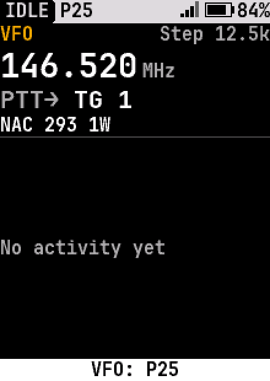
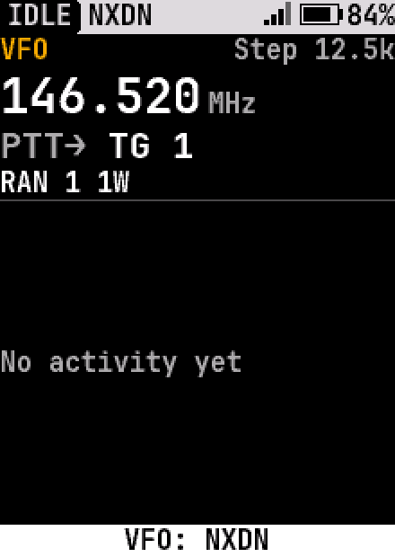

<!-- SPDX-License-Identifier: GPL-3.0-or-later -->

# DMR PTT release recovery — November 15, 2026

The report was a DMR transmission that stayed in TX after PTT was released. The affected radio and its exact
fault trace were unavailable; the on-device cause is not established. Two software failure modes were reproduced
in host tests and corrected in patch 0025:

- RF slot events refreshed the stall timer even when the modem stopped consuming the queued superframe. Release
  and the TX timeout now impose an absolute 1500 ms deadline, reused through the terminator drain.
- The HR_C7000 abort only set a request flag, depending on another slot interrupt. It now drops RF, empties the
  queue, restarts receive, and reports TX done before returning. The unused deferred-abort flag was removed.
  The PA one-shot is canceled on abort and RF-off; an expired timer cannot key an idle engine.

Normal release still sends complete A-F voice superframes and the terminator. Band, battery, calibration, busy
channel, ID, and timeout checks are retained. P25 trunking transmit remains disabled.

## Validation

- Before the fix: the new regressions produced 8 call-stack failures and 17 driver failures.
- After the fix: dmrCallTest 7723 checks with zero failures; HR_C7000 tests pass with and without split-hotspot
  support. The three suites also pass with AddressSanitizer and UndefinedBehaviorSanitizer.
- Release tests cover all 36 ten-millisecond offsets in a superframe, stuck queues with continuing RF events,
  TX timeout, clock wraparound, and a new call after recovery. Abort tests cover unarmed, armed, keyed, and
  draining states without another slot interrupt, duplicate abort, and a late RF interrupt.
- The complete derivative host suite passes, including UI layout: 4719 screens, zero layout problems.
- Root make test, NXDN, P25 trunking, and receive-audio tests pass. Documentation links: 145 files, zero broken links.
- Patch series matches the generated tree. Target build has zero compiler warnings and passes the stack audit:
  the smallest calculated task margin is 136 bytes. FLASH approximately 553 kB; static RAM 211440 of 211456 bytes.
  Static RAM is close to its linker limit; the configured RTOS heap and task stacks are unchanged.

Patch 0024 adds the exact supplied picture, quantized for the display, and the NXDN-P25-DM32 name. The boot text
from the codeplug remains. The picture drawing has a host pixel comparison test and simulator previews; the gallery
was rendered for five display classes. The build identifier now uses the derivative source commit.

## Hardware check still required

No radio was flashed, contacted, or made to transmit during this work. The supplied report has not been
confirmed fixed on its radio. Check repeated short and long DMR calls in direct mode and through a repeater:
release must return to receive, the next PTT must work, and received voice must still play. Confirm physical
PTT operation as well as the boot screen, talk permit, and return from the TX timeout.

The added `test_dmr_ptt_release_returns_to_receive` in the derivative's `tests/hil/test_dmr_tx.py` provides an
opt-in on-radio release/rekey check on the configured legal test channel. It requires the existing `--allow-rf`
gate and was syntax-checked only here. A receiver or power meter must independently confirm the carrier is off;
the status view alone cannot establish that.

Public release assets contain only the codec-free image, manifest, and SHA256SUMS. AMBE stays in the user's own
radio or stock file and is handled locally by the web flasher.

## Four-mode VFO in this Hotfix

Quick settings > Mode cycles FM, DMR, P25, NXDN, then FM. The mode survives a reboot. P25 starts with NAC 0x293,
NXDN with RAN 1, and both with TG 1. A programmed conventional digital channel can be copied to the VFO to keep
another NAC/RAN and group; both are saved without enlarging the settings record. The radio's own ID is used.
NXDN still rejects transmit IDs outside its valid range. Trunking is excluded from the cycle.

The new host checks cover P25 and NXDN selection, frequency stepping, RX/TX routing with ID 4001, PTT release,
restart, copied custom NAC/RAN/group, corrupt saved values, and rejection of invalid modes. The radio-core suites
pass 2260 checks for the multimode build and 2190 for NXDN without P25, also with ASan/UBSan. The FM/DMR-only VFO
tests still pass. UI flows cover the four-mode cycle and returning from channels. The multimode layout check
covers 4771 screens with zero problems; the gallery includes both new VFO views. This remains host validation;
the new VFO modes have not been checked on physical hardware in this task.

## Intermittent repeater access report

The additional report says repeater TX sometimes fails and rebooting helps. This exact RF failure has **not**
been reproduced or confirmed fixed. The Hotfix must not be described as a verified fix for every repeater issue.

Additional tests pass on TS1 and TS2 without reinitializing the stack: repeated failed wake-ups followed by
successful calls, a rejected call followed by a successful call, and an HR_C7000 aligned call aborted while
waiting for repeater timing followed by fresh timing acquisition and TX. The extended call suite passes 7751
checks; the normal and split HR_C7000 suites also pass, all with ASan/UBSan. These tests exercise recovery paths
covered by the PTT/abort fix; no speculative RF timing or calibration change was added for the new report.

Confirm repeated access, correct CC/TS and frequency pair, and actual RF bursts on the affected repeater before
claiming that intermittent access is resolved. Record the displayed denial and modem diagnostics if it recurs.
